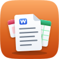
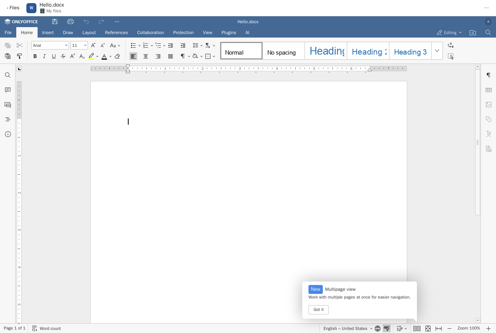
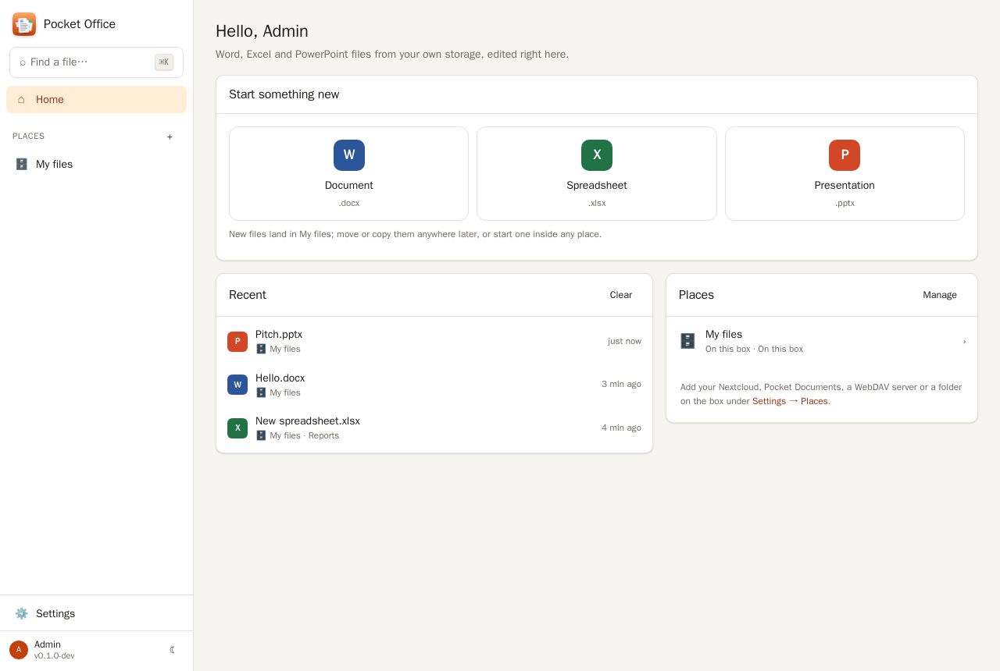
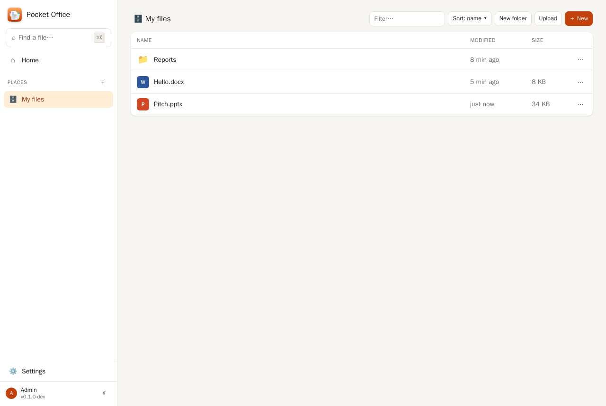
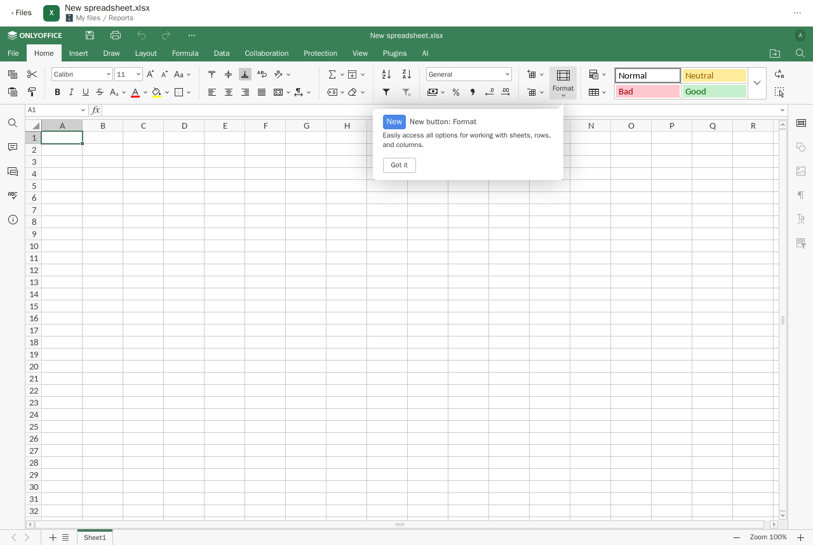
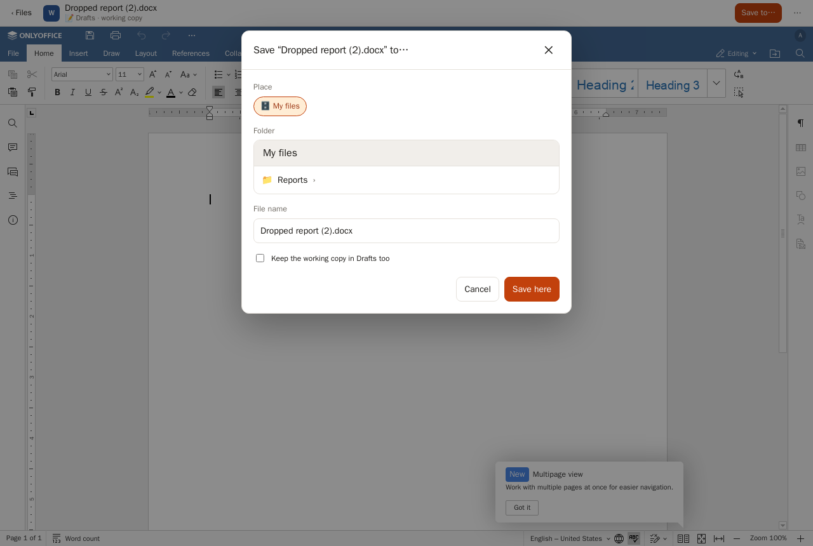
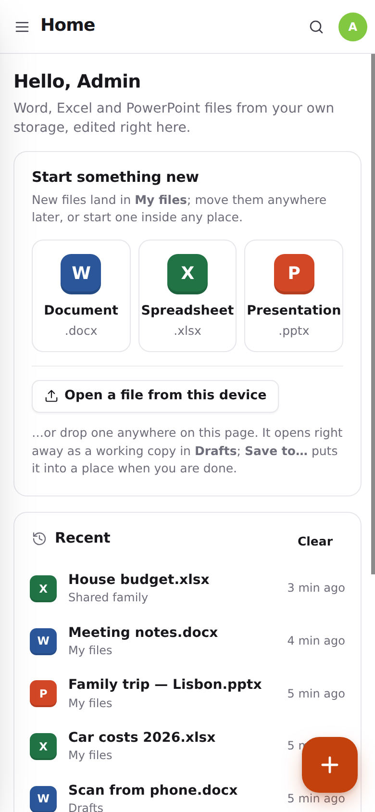
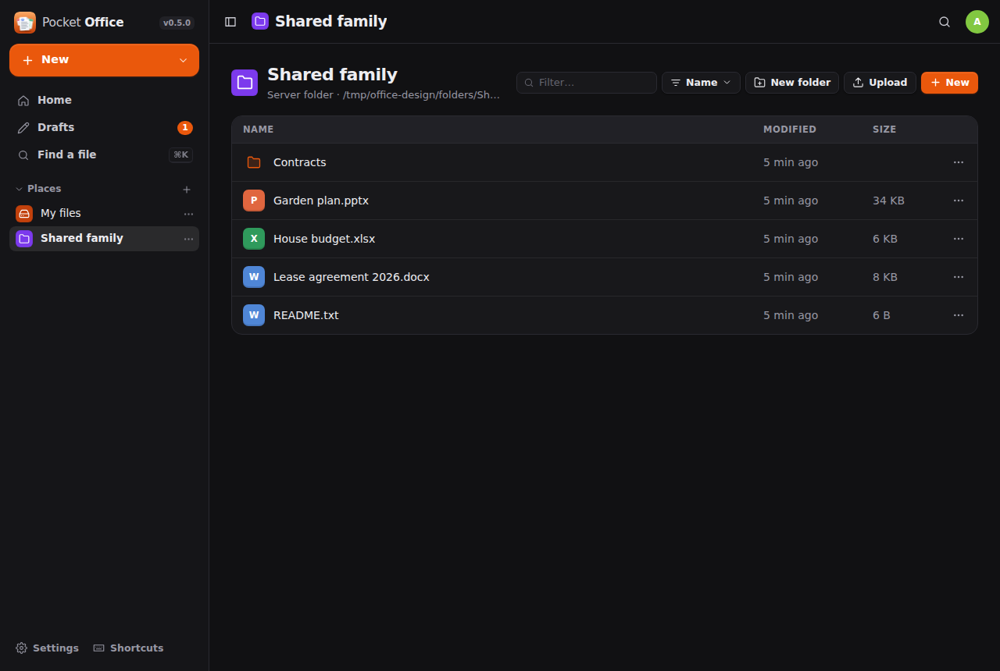

<p align="center"></p>
<h1 align="center">Pocket Office</h1>
<p align="center">Word, Excel and PowerPoint files opened and edited in the browser — from your Nextcloud, your Pocket Documents archive, Pocket Files, any WebDAV server or a folder on the box.<br>One Go binary, one SQLite file, one volume, and an ONLYOFFICE Document Server doing the rendering.</p>

Pocket Office does not try to draw a `.docx` itself. The part that has to be near-native — the layout engine,
the ribbons, tracked changes, pivot tables, slide transitions — is **ONLYOFFICE Document Server**, the same
engine Nextcloud and Seafile embed, running in your own container. Pocket Office is everything around it that a
household needs: who you are, where your files live, a file browser, new documents, uploads, conversions, and
the plumbing that makes Document Server fetch a file from the right place and write the result back when you
close it. Co-editing, autosave, comments and version-safe saves come with it.

<p align="center"></p>

## Screenshots

<table>
  <tr>
    <td width="50%"></td>
    <td width="50%"></td>
  </tr>
  <tr>
    <td width="50%"></td>
    <td width="50%"></td>
  </tr>
</table>
<p align="center">
  &nbsp;&nbsp;
  
</p>

## What it does

**Files from wherever they are**
- Each person adds their **places**: a folder on the box (built in, always there), their **Nextcloud** files
  (through Pocket Core, nothing to type — or address + app password), their **Pocket Documents** archive
  (through Pocket Core or an API token), their **Pocket Files** home or a folder in it (through Pocket Core),
  any **WebDAV** folder, or a server folder the admin offers
  (`FOLDER_ROOTS`). Nothing is copied: a file is read when opened and written back where it came from.
- Browse folders, upload (drag and drop too), new folders, rename, move, duplicate, delete; ⌘K finds a file by
  name across every place; recent files on the home page.
- **New document / spreadsheet / presentation** from blank templates, in any place.
- **Drop a file anywhere** (or *Open a file from this device*) and it opens at once as a working copy in
  **Drafts**, autosaved there while you edit; **Save to…** force-saves and moves it into the place and folder you
  pick. Nothing touches your Nextcloud or archive until you say so.

**Two engines**
- **ONLYOFFICE Document Server** (default): the editor runs in the browser and draws the document itself —
  snappy once loaded, heavier on the machine.
- **Collabora Online** (optional): the document is drawn on the server and streamed as tiles over WOPI —
  light on the browser, needs a steady connection. Each person picks a default under Settings → Account, and
  the ⋯ menu in any open file switches engines for that file. Both save into the same places with the same
  conflict guard.

**Editing with ONLYOFFICE**
- What opens, edits and converts comes straight from Document Server's own format manifest (86 types):
  `.docx`, `.xlsx`, `.pptx` with their macro-enabled and template variants (`.docm`, `.dotm`, `.xlsm`, `.xltm`,
  `.pptm`, `.potm`, `.ppsm`…), ODF, `.rtf`, `.txt`, `.csv`, `.html`, `.epub` open in the full editors; `.pdf`
  in the PDF editor; `.doc`, `.xls`, `.ppt`, `.pages`, `.numbers`, `.key`, `.hwp`, `.wps` and friends open in the
  viewer with **Edit a copy** one click away; Visio `.vsdx` opens in the diagram viewer.
- Autosave while you type, force save, and a real save when the last person closes the document. Saves are
  guarded by the file's ETag: if something else changed the file meanwhile, the edit is kept beside it as a
  `(conflict …)` copy rather than overwriting.
- Two people opening the same file get the same document session — live co-editing, comments, chat.
- **Download as…** any type Document Server converts to — for a document that is PDF, PDF/A, docx/docm/dotx/dotm,
  odt/ott, rtf, txt, html, epub, fb2, md and page images; similar lists for sheets and slides.
- On phones the free Document Server views; an **Edit** button opens the full desktop editor on the phone.
- Light and dark theme, passed on to the editor.

**Reviews with Pocket Collaborator**
- Any file can be sent for review: it is rendered to PDF and lands in Pocket Collaborator with a link back; a file
  already in review gets a new revision. Files in review carry an *In review* badge in the list and the editor that
  opens the review. Works for drafts too, and follows the draft when it is saved into a place.

**A Pocket app**
- Multi-user: the first account is the admin; others get accounts or sign in with **Pocket Core**. Everything
  is strictly per person: places, recent files, tokens.
- With Pocket Core: registered as `office`, Nextcloud credentials and the Pocket Documents and Pocket Files links per person, events
  `office.opened` / `office.saved` / `office.created`, `files:read` offered to other apps, Core device tokens
  accepted as API tokens.
- JSON API with bearer tokens (`po_…`), `/dashboard` for a Homepage widget, `/healthz`, `/metrics`.
- Document Server is set up once by the admin (Settings → Document Server has a **Test** that proves the
  round trip: health, and Document Server fetching a file from this app and converting it).

## Run it

You need an [ONLYOFFICE Document Server](https://github.com/ONLYOFFICE/DocumentServer) (the Community build is
fine; the compose file below starts one). Pocket Office and Document Server must be able to reach each other:
browsers load the editor from Document Server, Document Server downloads files from Pocket Office.

```yaml
services:
  office:
    image: ghcr.io/abjelosevic88/pocket-homelab-office:latest
    ports: ["8080:8080"]
    environment:
      BASE_URL: https://office.example.com          # what browsers use
      ADMIN_EMAIL: you@example.com
      ADMIN_PASSWORD: change-me-please
      ONLYOFFICE_URL: https://onlyoffice.example.com # what browsers load the editor from
      ONLYOFFICE_INTERNAL_URL: http://onlyoffice:80  # how this server reaches it
      ONLYOFFICE_JWT_SECRET: ${ONLYOFFICE_JWT_SECRET}
      CALLBACK_URL: http://office:8080              # how Document Server reaches this app
    volumes: ["./data:/data"]
  onlyoffice:
    image: onlyoffice/documentserver:9.4.0.1
    ports: ["8081:80"]
    environment:
      JWT_ENABLED: "true"
      JWT_SECRET: ${ONLYOFFICE_JWT_SECRET}
      JWT_HEADER: AuthorizationJwt
      ALLOW_PRIVATE_IP_ADDRESS: "true"              # Pocket Office lives on a private address
```

Open `BASE_URL`, sign in with the admin account, go to Settings → Document Server → **Test**, then add your
places. The full list of variables, the API and how a save travels are in [docs/configuration.md](docs/configuration.md).
Already running Document Server for Nextcloud? Point `ONLYOFFICE_URL` at it and reuse its JWT secret — one
Document Server serves both.

Binaries for Linux, macOS, Windows and FreeBSD are on the [releases](https://github.com/abjelosevic88/pocket-homelab-office/releases) page;
`pocket-office` with the same environment variables does the same thing without a container (it still needs a Document Server).

## Build it

```
make web      # React UI → web/dist (Node 22)
make build    # Go binary with the UI embedded (Go 1.26, CGO off)
make test     # go vet + go test + tsc
make docker   # the container image
```

`make dev` runs the API on :8080 and Vite on :5173 with hot reload. `AUTH_MODE=none` skips sign-in while developing.

Editor browser regressions run with `cd web && npx playwright install --with-deps chromium && npm test`.
They cover PDF/Word menus, editor errors, and engine switching without requiring a Document Server.
To use an existing Docker Chromium instead, set `PLAYWRIGHT_CDP_URL` to its local debugging address.

## Part of the Pocket family

Pocket Office follows the same shape as the other Pocket apps — Go + chi + SQLite, React + Vite, one binary,
Pocket Core for people, services and links — and sits next to
[Pocket Documents](https://github.com/abjelosevic88/pocket-homelab-documents) (the archive it edits in),
[Pocket Notes](https://github.com/abjelosevic88/pocket-homelab-notes) and
[Pocket Core](https://github.com/abjelosevic88/pocket-homelab-core). The storage backends (local folder, WebDAV,
Nextcloud) are shared code with Notes and Documents.

ONLYOFFICE is a trademark of Ascensio System SIA and Collabora Online of Collabora Productivity Ltd; Pocket Office
is an independent client of both (ONLYOFFICE's JavaScript API and WOPI respectively) and ships the Document
Server's own blank `new.docx` / `new.xlsx` / `new.pptx` as templates.

## License

MIT.
